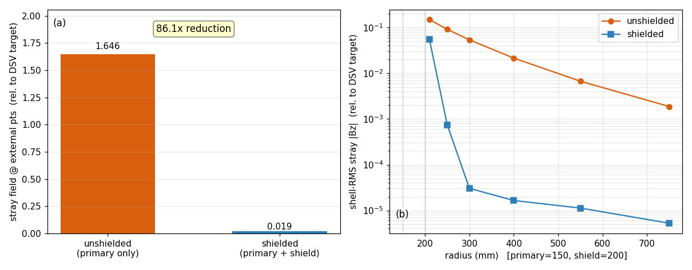
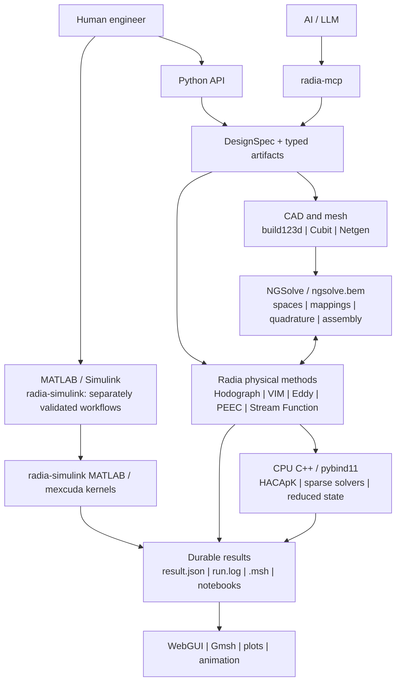
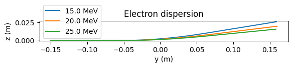

# Radia

<p align="center">
  <strong>Electromagnetic CAE you can operate through AI and MCP</strong><br>
  Connect CAD, mesh control, field analysis, and result inspection on NGSolve,
  through the Python CPU API and MCP tools.
</p>

<p align="center">
  <a href="https://github.com/ksugahar/Radia/actions/workflows/build-test.yml"></a>
  <a href="https://github.com/ksugahar/Radia/actions/workflows/radia-mcp-matrix.yml"></a>
  <a href="https://pypi.org/project/radia/"></a>
  <a href="https://pypi.org/project/radia-mcp/"></a>
  <a href="https://github.com/ksugahar/Radia/releases"></a>
  <a href="LICENSE"></a>
  <a href="https://github.com/ksugahar/Radia/stargazers"></a>
</p>

<p align="center">
  
</p>
<p align="center">
  <sub>Design for a field target: a stream-function active-shield demonstration.
  This comparison is for the illustrated coil configuration, not a universal
  shielding-performance claim.</sub>
</p>

**You set the analysis direction. AI helps operate the CAE tools.**

Radia is an open-source electromagnetic CAE platform that an AI assistant can
operate through MCP. Specify the analysis task and conditions; connected tools
can prepare geometry, control meshing, execute supported calculations, and
inspect results. This reduces the need to memorize each tool's commands and
interaction sequences while keeping the model and results inspectable.

Start with `radia` for CPU calculations in Python and `radia-mcp` for AI-assisted
tool operation. The CPU solver builds on NGSolve and does not require MATLAB.

**Radia's operating manual is distributed as `radia-mcp`.** Detailed usage,
recipes, validation catalogs and tool contracts are served to your AI
assistant through `radia-mcp`: ask it, starting with `capability_pack_status`
and the domain usage tools it reports. This README introduces capabilities; it
is not the manual.

Radia supports two ways of working. In **AI-driven execution** (Python through
MCP), you set the analysis plan, physical assumptions and acceptance criteria,
and the AI assistant executes supported calculation workflows end to end;
you evaluate the engineering conclusions. In **human–AI collaborative
operation**, you and the assistant develop and inspect CAD and mesh artifacts
using Coreform Cubit, and system models using masked blocks in the Radia
Simulink library. The assistant operates Cubit in batch/nographics mode,
with journals, checkpoints and exported artifacts supporting human inspection
and handoff.

| Start with | Use it for |
| --- | --- |
| `radia` | CPU electromagnetic calculations through Python, pybind11 and NGSolve |
| [`radia-mcp`](packages/radia-mcp/README.md) | Discovering workflows and operating supported analysis tools through an AI assistant |
| [`cubit-mesh-export`](packages/cubit-mesh-export/README.md) | Optional Coreform Cubit mesh export and strict solver-mesh checks |

MATLAB GPU development and other independently released packages are described
under [Related distributions](#related-distributions).

Start from supported CAD, mesh, or model data where available, instead of
rebuilding every input. What transfers depends on the format and workflow;
materials, sources, boundary conditions, and units still need to be checked.
The user defines the physical assumptions, analysis plan, and acceptance criteria
and evaluates the engineering conclusions. Radia's current positioning is
AI-operable CAE, not autonomous design decision-making.

Radia is deliberately **not** another monolithic finite-element solver. It is
built on [NGSolve](https://ngsolve.org/), which remains the numerical
foundation for finite-element spaces, mappings, quadrature, weak forms,
assembly, and field evaluation. Radia adds electromagnetic methods,
open-boundary operators, application workflows, native kernels, and
orchestration around that foundation.

> **Radia extends NGSolve; it does not compete with it.**

[Python capabilities](#what-you-can-do-in-python) | [Quick start](#quick-start) |
[Analysis with MCP](#python-and-mcp) | [Related distributions](#related-distributions) |
[Eqnedit64](#eqnedit64) |
[Documentation](#documentation) | [Contributing](#contributing)

## Find your next engineering workflow

Use the documentation to discover capabilities and inspect results. Carry out
CPU analysis through Python or MCP, using checked CAD and mesh artifacts.
Human–AI collaboration through Cubit and supported MATLAB/Simulink workflows
is also available; MATLAB/Simulink belongs to the independent
[radia-simulink package](packages/radia-simulink/README.md).
The executable samples live in [tests/](tests/README.md) for small usage and
contract examples, and [validation_test/](validation_test/README.md) for physics
and application cases with numerical evidence.

[**Start here**](docs/START_HERE.md) · [**Result gallery**](docs/APPLICATION_GUIDE.md#browse-results) ·
[**Accuracy and validation**](docs/VALIDATION_GUIDE.md)

| Explore | What you will find |
| :--- | :--- |
| [Calculate your first field](#quick-start) | A small analytical magnet example with SI inputs and output |
| [See geometry and results](docs/APPLICATION_GUIDE.md#browse-results) | A curved coil, motor torque and thermal response, linked to their conditions and saved calculations |
| [Inspect the numerical evidence](docs/VALIDATION_GUIDE.md) | Analytical references, force checks, holdout comparisons and their limits |
| [Choose an interface and get help](docs/START_HERE.md#choose-how-you-want-to-work) | Python/MCP setup, installation and reproducible issue reports |

## What you can do in Python

Use Radia to calculate magnetic fields, study material and conductor response,
and build field-design loops on a CPU. Start with a small analytical model,
or use NGSolve when the problem needs a mesh and finite-element formulation.

| Your task | Python capabilities | Start with |
| --- | --- | --- |
| Calculate a magnet or coil field | Permanent magnets, finite-section coils, open-space field evaluation, forces and torque | [First field calculation](#quick-start), [coil sample](tests/test_coil_axis_closed_form.py) |
| Analyze magnetic materials | Linear and nonlinear magnetization, demagnetizing fields, HDiv volume-integral methods and open-boundary operators | [HDiv-VIM guide](docs/hdiv_vim/README.md) |
| Design a coil for a target field | Stream-function inverse design, current contours and connected winding paths | [Stream-function guide](docs/stream_function/README.md), [field cross-check](validation_test/stream_function/README.md) |
| Study eddy currents and shielding | NGSolve HCurl workflows, boundary-integral and surface-impedance methods, reduced response models | [Eddy-current method guide](docs/solver/EDDY_CURRENT_METHODS.md) |
| Extract conductor and circuit behavior | PEEC resistance and inductance, skin/proximity effects, circuit coupling and reduced models | [PEEC guide](docs/peec_integration/README.md) |
| Study precision magnets and particle motion | Pole design, field multipoles, field sampling and charged-particle trajectories | [Hodograph guide](docs/clebsch_hodograph/README.md), [saved particle example](docs/gmsh_post/em_particle_orbits.ipynb) |
| Optimize and inspect a model | Objective/constraint-driven design loops, field visualization and numerical comparisons | [Capabilities](#capabilities), [validation guide](docs/VALIDATION_GUIDE.md) |

The analytical magnet example below is the shortest starting point. Other
families have their own mesh, material, dependency and validation requirements;
the linked guides and MCP tools describe those prerequisites. HDiv-MMM topology
optimization remains an active development and validation priority.

**Open boundaries and inspectable results are central to Radia.** Analytical
sources and integral/open-boundary methods can avoid a large surrounding air
mesh where the chosen formulation permits it. NGSolve owns finite-element
spaces and assembly; Radia adds electromagnetic formulations and coupling.
Use independent references and convergence studies to judge a result for your
model. A solver residual alone does not establish physical accuracy.

## Quick start

The current production wheel targets **Windows x64**, **Python 3.12**, and
**NGSolve/Netgen 6.2.2607**.

```powershell
python -m pip install --upgrade radia
```

Evaluate an analytical open-boundary magnetic field in SI units:

```python
import numpy as np
import radia as rad

mu0 = 4.0 * np.pi * 1e-7
remanence_t = 1.2

magnet = rad.ObjRecMag(
    [0.0, 0.0, 0.0],
    [0.01, 0.01, 0.01],
    [0.0, 0.0, remanence_t / mu0],
)

b_t = rad.Fld(magnet, "b", [0.0, 0.0, 0.02])
print(f"Bz [T] = {b_t[2]:.8f}")
rad.UtiDelAll()
```

```text
Bz [T] = 0.02356629
```

This first example needs no air mesh. Move to NGSolve when the problem needs
finite-element spaces, material domains, weak forms, or coupled field
equations.

Turn solved SI field samples into electromagnetic force and torque through
Lorentz volume integration, air-side Maxwell stress, time-averaged complex
phasors, virtual work/coenergy, or a cylindrical air-gap shear estimate:

```python
from radia.force import integrate_lorentz_force

# One quadrature sample: J = 2 MA/m^2 in +z, B = 0.3 T in +y,
# with 2.5 cm^3 of physical volume. The force points in -x.
force_n = integrate_lorentz_force(
    [0.0, 0.0, 2.0e6],
    [0.0, 0.3, 0.0],
    2.5e-6,
)
print(force_n)  # [-1.5, 0.0, 0.0] N
```

Supplying quadrature positions and a pivot to
`integrate_lorentz_force_and_torque` returns both resultants.
The [force and torque validation corpus](validation_test/force_validation/README.md)
records the Lorentz, Maxwell-stress, and virtual-work checks used to verify
signs and force extraction before attaching them to a production field solve.

Install only the integrations you need:

```powershell
# AI-facing domain tools and executable workflow knowledge
python -m pip install radia-mcp

# Coreform Cubit export and strict .vol checking
python -m pip install "radia[cubit]"
cubit-plugin-install
cubit-plugin-install --verify-only

# Optional accelerator tracking and topology-to-CAD workflows
python -m pip install "radia[beam]"
python -m pip install "radia[topopt-cad]"
```

See [Installation](#installation) for package requirements and source builds.

## Interfaces

### Python and MCP

Python exposes the CPU calculations. **MCP (Model Context Protocol) connects an
AI assistant to tools that can inspect inputs, prepare models, run supported
calculations, and inspect results.** Install the solver for numerical execution
and the MCP package for the assistant's tool interface:

```powershell
python -m pip install radia radia-mcp
```

Then register the required servers in your MCP client; installation alone does
not connect them. See [client configuration](packages/radia-mcp/README.md) and
[capability packs](packages/radia-mcp/docs/design/capability_packs.md). Connect
only the domains needed for the task. Cubit operation uses the independently
installed `cubit-mesh-export` server and a licensed Cubit installation.

For example, you can ask an assistant:

> Analyze the on-axis magnetic field of a circular coil in air. Use a radius of
> 50 mm, 100 turns and 1 A DC. Evaluate Bz from -100 mm to +100 mm on the axis.
> State the conductor approximation and compare the result with the analytical
> circular-loop field. Report the error and save the inputs, plot and results.

This is an example analysis request, not a record of an executed run. The
assistant should establish the supported coil representation and comparison
criteria before calculating. A finite-section winding and an ideal filament
are different physical models.

| Step | What the assistant does through the connected tools | What you can inspect |
| --- | --- | --- |
| 1. Discover the route | Checks server status, available tools and the relevant usage/recipe guidance | Required software, supported model and chosen analysis method |
| 2. Establish the model | Records SI units, geometry, material, excitation, approximation and acceptance criteria | Explicit assumptions and quantities to calculate |
| 3. Prepare checked inputs | Creates or imports geometry and, where needed, meshes and validates domain/boundary labels | Geometry, mesh, label checks and physical configuration |
| 4. Execute the calculation | Runs the selected Python CPU workflow with its convergence checks | Calculation output, convergence information and failures |
| 5. Validate and report | Compares an appropriate reference or refinement study and saves the requested artifacts | Field values, plots, error measures and the supported conclusion |

The simple analytical example needs no mesh. Mesh-based workflows pass their
solver-bound `.vol` through `check-vol` with the required label contract. AI
operation of Cubit is headless; journals, checkpoints and exported artifacts
support inspection and handoff.

For capability packs, start with `capability_pack_status`; follow the domain
status and usage tools it reports. The checked `radia_mcp.meta` catalog provides
discovery metadata and each connected server's live `tools/list` gives its
available tools. Tools may return guidance or prepare scripts as well as execute
calculations: inspect their contract and returned artifacts rather than assuming
every operation performs a solve.

You define the analysis purpose, physical assumptions and acceptance criteria,
and judge the engineering conclusion. MCP supplies the current operating
guidance and tool contracts; this README and the saved documentation examples
introduce capabilities. Knowledge tools can work without the native solver,
but numerical execution requires the selected backend and its dependencies.
Unsupported inputs or unavailable backends must be resolved explicitly.

## Architecture



Supported CPU workflows can be driven by a Python program or an AI assistant
through MCP. The physical model and numerical checks remain explicit.

### Responsibility boundaries

| Layer | Owns |
| :--- | :--- |
| **NGSolve / ngsolve.bem** | FE spaces, element orientation, Piola maps, curved geometry, quadrature, weak-form assembly, GridFunctions, and BEM operators |
| **Radia C++ and Python** | Analytical fields, electromagnetic physical methods, open-boundary operators, material/circuit coupling, reduced models, and artifact schemas |
| **[MATLAB / Simulink (radia-simulink)](packages/radia-simulink/README.md)** | Human-facing composition, typed signals, lifecycle and CUDA MEX execution within the independently validated package scope |
| **radia-mcp** | Executable domain knowledge, tool discovery, workflow selection, validation guidance, and AI orchestration |
| **CAD and visualization tools** | Geometry/mesh authoring and durable inspection through explicit STEP, VOL, MSH, and result boundaries |

## Capabilities

### Executed feature notebooks

These existing notebooks contain saved code outputs. Their linked derivations
and validation records define the evidence scope; saved output is not a new
release acceptance run.

| Feature | Executed introduction | Method and evidence reference |
| :--- | :--- | :--- |
| HDiv-MMM topology optimization | [Density adjoints and exact-void checks](docs/hdiv_vim/isochronous_topopt.ipynb) | [Formulation and verification scope](docs/hdiv_vim/TOPOLOGY_OPTIMIZATION_ISOCHRONOUS.md) |
| NGSolve integration | [Spaces and field evaluation](docs/ngsolve_integration/integration_basics.ipynb) | [NGSolve](https://ngsolve.org/) |
| Stream-function coil design | [Regularization](docs/stream_function/regularization.ipynb) | [Stream-function methods](docs/stream_function/README.md) |
| Spatial effective surface impedance | [ESIM demonstration](docs/esim_spatial/esim_spatial_demo.ipynb) | [ESIM formulation](docs/esim/README.md) |
| Field visualization and trajectories | [Particle orbits](docs/gmsh_post/em_particle_orbits.ipynb) | [Gmsh post-processing](docs/gmsh_post/README.md) |

### Analytical and open-boundary magnetics

Radia retains the analytical magnetostatic strengths of the original Radia
project: permanent magnets, coils, source fields, forces, energies, and field
evaluation in open space. Around those sources, the current platform provides
Kelvin transformations, exterior DtN formulations, infinite elements,
equivalent sources, and integral formulations for problems where truncating a
large air domain is undesirable.

Radia targets the **magneto-quasi-static to Darwin regime**. Its propagation
kernels are Laplace kernels; frequency enters conductor physics through skin
depth, impedance, and reduced dynamics. Radia is not a full-wave Helmholtz
solver for radiation-dominated problems.

### Clebsch-Hodograph design

Hodograph methods transform selected nonlinear magnetic-design problems into
tractable design problems in a transformed coordinate space. The implementation
supports flux-line and pole-face design, field-quality studies, end effects,
and accelerator-magnet workflows.

- [Clebsch-Hodograph documentation](docs/clebsch_hodograph/README.md)
- [Result-bearing accelerator design notebooks](docs/clebsch_hodograph/demos/README.md)

### HDiv-MMM topology optimization and magnetic materials

HDiv-MMM (the HDiv magnetic-moment method) is the priority development route
for material topology optimization. Its density adjoints, constrained design
loops and exact-void checks are demonstrated on verification-scale models;
these do not establish engineering-scale optimization acceptance.

The HDiv Volume Integral Method uses NGSolve meshes and finite-element spaces
while Radia supplies the magnetic charge-Gram and open-boundary interaction.
The C++ HACApK path provides compressed operators for large repeated actions,
and the Python surface uses NGSolve's field and space vocabulary.

This is Radia's forward path for soft magnetic materials, nonlinear
magnetization, demagnetizing fields, topology-aware material design, and
independent FEM/integral cross-checks.

- [HDiv-VIM documentation](docs/hdiv_vim/README.md)
- [Open-boundary method map](docs/open_boundary/OPEN_BOUNDARY_MAP.md)

### Eddy currents, SIBC, and ESIM

Radia combines high-order NGSolve HCurl discretizations with BEM-A, surface
impedance, effective surface impedance, cohomology handling, and reduced
models. The `Eddyable` concept packages response bases for repeated
low-frequency solves while preserving the underlying field formulation.

- [Eddy-current method guide](docs/solver/EDDY_CURRENT_METHODS.md)
- [ESIM formulation and usage](docs/esim/README.md)
- [Foster, PRIMA, and Modal-bulk SIBC models](docs/solver/REDUCED_EDDY_MODELS.md)

### Stream functions and coil topology

The stream-function layer solves inverse source problems for target magnetic
fields, supports regularized ACA+ / TSVD compression, extracts current
contours, and turns them into connected winding paths. It is used for planar,
cylindrical, and free-form current sheets as well as field-shaping and coil
optimization.

- [Stream Function documentation](docs/stream_function/README.md)
- [Single-stroke winding policy and algorithms](docs/stream_function/single_stroke.md)

### PEEC, circuits, and model reduction

PEEC workflows cover partial inductance, resistance, proximity and skin
effects, shield coupling, circuit assembly, and SPICE-compatible extraction.
PRIMA, block Lanczos, Foster modal models, and universal relaxation networks provide reusable
reduced models for circuit and transient studies.

LTspice and MATLAB/Simulink integration belong to the separate
[radia-simulink distribution](packages/radia-simulink/README.md).

- [PEEC integration](docs/peec_integration/README.md)
- [SPICE and LTspice integration](docs/ltspice/README.md)
- [Universal relaxation networks](docs/universal_relaxation_network/model_inventory.md)

### Optimization and geometry regeneration

Radia supports global, local, and gradient-based design loops:

- TPE, CMA-ES, GP, NSGA-II/III, QMC, and finite define-by-run search;
- analytic-adjoint MMA and SQP for continuous field optimization;
- HDiv-VIM and HCurl material topology;
- stream-function, sheet-metal, and electromagnet topology optimization;
- density/level-set to watertight STL and checked Cubit/Netgen mesh
  regeneration.

Optimization is tied to the same mesh, material, result, and provenance
contracts as direct analysis. A new geometry is not accepted merely because
an optimizer produced it.

### Accelerator fields and particle trajectories

Radia's C++ core provides inspectable SI field sampling, relativistic Lorentz
equations, RK4/Boris steps, fixed-step trajectories, and distributed R/T/U
transfer attribution. It can also hand solved magnetic fields to CERN Xsuite
for accelerator-coordinate tracking or use SciPy for adaptive trajectories,
event handling, and closed-orbit workflows. Gmsh exports preserve trajectory
quantities and can animate a beam through the solved field.

For high-order map analysis, NGSolve remains the source of truth for conforming
HCurl/HDiv projection and curved finite-element evaluation. Radia adds a
tracking-specialized CanonicalHCurl vacuum chain fitted from full-volume field
samples, with adaptive fringe grading, periodic ring closure, and direct
longitudinal-polynomial coupling to a nonautonomous fourth-order Lie-map
integrator. Independent canonical A-map and projected B-map Runge--Kutta routes
keep field-projection error separate from Lie truncation error.

<p align="center">
  
</p>

- [Executed particle-orbit notebook](docs/gmsh_post/em_particle_orbits.ipynb)
- [Native beam and transfer API design](docs/api/EARLY_TIMES_CPP_API_DESIGN.md)
- [Canonical HCurl and Lie-map validation](validation_test/ffag_topopt/README.md)
- [Gmsh post-processing guide](docs/gmsh_post/README.md)

## Related tools and documentation

### Related distributions

This monorepo independently releases `radia`, `radia-mcp`, `cubit-mesh-export`,
`radia-simulink`, `radia-optuna`, and `eqnedit64`.

CPU execution belongs to `radia` through Python/pybind11 and NGSolve.
GPU kernels belong to `radia-simulink`, are compiled with MATLAB mexcuda, and
may be called from MATLAB or Python within each validated route.

[`radia-simulink`](packages/radia-simulink/README.md) owns MATLAB, Simulink, LTspice
integration, and MATLAB mexcuda development. GPU support is under development;
consult that package for validated capabilities. It does not yet provide a GPU
equivalent of the full Python CPU feature set.
An explicitly selected CPU route compiled with mexcuda is permitted after API
tracing proves that it creates no CUDA context, with and without a device.
There is no separate CPU-only MEX build. CPU and GPU selection is explicit,
with no implicit fallback. Python CPU accuracy checks remain independent of
the shared CUDA kernels and are not a GPU-user prerequisite.
The GPU toolchain uses MATLAB-bundled CUDA 12.8 and Visual Studio Build Tools
2022 / MSVC 14.44; see the package guide for build and validation requirements.

[`radia-optuna`](packages/radia-optuna/README.md) independently owns MATLAB
optimization workflows. [Eqnedit64](#eqnedit64) is the independent equation editor.
These packages are separate from installing and using the Python CPU solver.

### Eqnedit64

[Eqnedit64](tools/eqnedit64) is an independently released Windows equation
editor with a browser edition and Python API. It connects structural input to
UTF-8 TeX and editable Office Math or image export. See the
[3.1.4 release](https://github.com/ksugahar/Radia/releases/tag/eqnedit64-v3.1.4)
and [package documentation](packages/eqnedit64/README.md).

### Documentation and visualization

`docs/**/*.ipynb` is the feature-introduction layer. Demonstrations are
executed notebooks with narrative, code, saved results, and
saved `ngsolve.webgui.Draw` or `netgen.webgui.Draw` scenes. They are not hidden
production workbenches. Executable samples live in `tests/` and
`validation_test/`. Benchmarks and numerical evidence live under
`validation_test/` with machine-readable JSON; docs notebooks need no sidecar.

Field-producing application runs write checked Gmsh `.msh v4.2` artifacts.
The Gmsh toolchain supports scalar/vector/tensor fields, sections, clipping,
isosurfaces, LIC, streamlines, file-series statistics, shared-camera
comparisons, and particle-track animation. Geometry is shown at physical
1:1:1 axis scale unless an explicit display exaggeration is recorded.

## Engineering contracts

Radia favors fail-loud, inspectable boundaries over convenient ambiguity.

| Contract | Rule |
| :--- | :--- |
| Units | Public geometry and field APIs use SI units; geometry is in meters and magnetic flux density is in tesla |
| Physical regime | Magneto-quasi-static to Darwin; Laplace propagation kernels, no hidden full-wave Helmholtz path |
| Finite elements | NGSolve owns orientation, mappings, quadrature, assembly, and GridFunction evaluation |
| Mesh interchange | Netgen `.vol` is the solver mesh boundary; STEP is geometry, not a labeled solver mesh |
| Mesh acceptance | Every solver-bound VOL passes `check-vol`; production modes add strict, versioned label contracts |
| Results | Runs write `run.log`, `result.json`, checks, hashes, and spatial `.msh` output where a field exists |
| Release | CPU package versions, source identity, native artifacts, and required numerical gates are verified for the same release commit; other distributions have independent release gates |

For Cubit-to-NGSolve workflows, Cubit produces the mesh and Radia/NGSolve
consumes it. The exporter does not infer material constants from labels;
conductivity, permeability, BH data, frequency, and other physics remain
explicit configuration.

## Installation

### Supported production stack

| Component | Current target |
| :--- | :--- |
| Operating system | Windows 10/11 or Windows Server, x64 |
| Python core | 3.12 |
| Lightweight radia-mcp | Python 3.10 or later |
| NGSolve / Netgen | 6.2.2607 |
| radia-simulink / radia-optuna MATLAB | R2026a (yearly a release only), Windows x64; separate package requirements apply |
| Coreform Cubit | 2026.8, optional |
| cubit-mesh-export Python | >=3.12,<3.13 |
| Native build | Visual Studio Build Tools 2022 / MSVC 14.44, CMake/Ninja, pip `mkl-devel` oneMKL |

### Python packages

This monorepo contains six independently versioned distributions. MATLAB,
Simulink and LTspice integration belongs to `radia-simulink`, including its
Python circuit-conversion and parser modules.

| Package or extra | Install | Purpose |
| :--- | :--- | :--- |
| `radia` | `python -m pip install radia` | C++ core, Python APIs, NGSolve integration, physical methods, and application logic |
| `radia-simulink` (source version 0.1.5rc1) | `python -m pip install radia-simulink` | MATLAB mexcuda solvers, Simulink and LTspice integrations; external products installed separately |
| `radia-mcp` | `python -m pip install radia-mcp` | AI-facing MCP servers and executable domain knowledge |
| `cubit-mesh-export` (2.2.3) | `python -m pip install cubit-mesh-export` | Solver-neutral high-order Cubit export, `check-vol`, plugin, and independently owned Cubit MCP |
| `radia-optuna` | `python -m pip install radia-optuna` | Standalone MATLAB Optuna namespace and 21-command native gateway; no Radia solver, NGSolve, or MKL runtime |
| `eqnedit64` (3.1.4) | `python -m pip install eqnedit64` | Windows equation editor, structural Python API, native TeX/MathML/SVG/clipboard backend, and Web assets |
| `radia[optuna]` | `python -m pip install "radia[optuna]"` | Radia plus pinned upstream Python `optuna==5.0.0`; MATLAB optimization requires the separate `radia-optuna` distribution |

Each distribution has its own release and validation gates. Record exact
package versions when reproducing a calculation. See the
[GitHub Releases page](https://github.com/ksugahar/Radia/releases) for artifacts
and release notes; the source version above is not a claim of a stable GPU release.

### Build from source

```powershell
git clone https://github.com/ksugahar/Radia.git
Set-Location Radia
python -m pip install -e ".[dev]"
python -m pip install -e packages/radia-mcp
python -m pip install -e packages/cubit-mesh-export
python -m pip install packages/eqnedit64
pwsh -NoProfile -ExecutionPolicy Bypass -File .\Build.ps1 -RadiaOnly
```

See [BUILD.md](BUILD.md) for compiler, NGSolve, MKL, and packaging details.

## Repository map

```text
src/core/                       C++ Radia and native electromagnetic kernels
src/radia/                      CPU Python package and NGSolve integration
packages/radia-simulink/             CUDA MEX, MATLAB, Simulink and LTspice integration
packages/radia-mcp/             MCP servers and executable domain knowledge
packages/cubit-mesh-export/     Cubit exporters, plugin and check-vol
packages/radia-optuna/          Independent MATLAB/Simulink Optuna package
packages/eqnedit64/             Windows Eqnedit64 Python/API distribution
tools/eqnedit64/                Native and browser equation editor source
tests/                          Small executable samples and fast regressions
validation_test/                Physics/application samples and validation gates
docs/                           Feature introductions, saved results and theory
tools/                          Build, policy, release and verification tools
```

Loose `examples/` scripts are retired. New experiments begin outside the
repository and are promoted only when they become a reusable API, focused
test, validation problem, or result-bearing docs notebook.

## Documentation

Start with the path closest to your task:

- [Documentation index](docs/README.md)
- [Python API reference](docs/api/API_REFERENCE.md)
- [Radia and NGSolve integration notebook](docs/ngsolve_integration/integration_basics.ipynb)
- [Analytical electromagnetic formulas](docs/analytical_formulas.md)
- [HDiv-VIM](docs/hdiv_vim/README.md)
- [Clebsch-Hodograph](docs/clebsch_hodograph/README.md)
- [Eddy-current methods](docs/solver/EDDY_CURRENT_METHODS.md)
- [Stream Function](docs/stream_function/README.md)
- [PEEC integration](docs/peec_integration/README.md)
- [Induction heating](docs/induction_heating/README.md)
- [Electric machines](docs/electric_machine/README.md)
- [Magnetic levitation](docs/maglev/demos/README.md)
- [Gmsh post-processing](docs/gmsh_post/README.md)
- [MATLAB and Simulink](packages/radia-simulink/matlab/README.md)
- [MCP servers and tools](packages/radia-mcp/README.md)
- [Cubit mesh export](docs/cubit_mesh_export/README.md)

## Contributing

Radia welcomes focused contributions to physical methods, NGSolve-native
integration, independent validation, CAD/mesh boundaries, CPU numerical checks,
documentation, and application workflows.

```powershell
# Run one focused regression while developing
python -m pytest -q tests/test_vim_eddy_hybrid.py

# Broaden only after the focused lane is green
python -m pytest -q tests
```

Fast regressions belong in `tests/`. Long numerical studies, convergence
sweeps, and benchmark-quality checks belong in `validation_test/`. These two
directories also provide executable samples. Feature introductions and saved
demonstrations belong under `docs/`; operational workflows use MCP or
human–AI collaboration through Cubit and Simulink. MATLAB/Simulink workflows
belong to their independently validated distributions.

- Read [CONTRIBUTING.md](CONTRIBUTING.md) before opening a pull request.
- Use the [issue tracker](https://github.com/ksugahar/Radia/issues) for bugs and
  concrete feature requests.
- Report vulnerabilities through the private process in
  [SECURITY.md](SECURITY.md).
- Include the smallest reproducible geometry/configuration and the generated
  `result.json` or checker report when reporting a numerical workflow issue.

If Radia is useful to your engineering or research, **star the repository**.
It helps other electromagnetic developers discover the project and follow its
progress.

## Project status

Radia is an active research and engineering platform. The core analytical
magnetostatics package is mature; newer VIM, Eddy, and optimization families
are developed behind explicit tests and release gates.
Not every method has the same maturity or platform coverage, and unsupported
paths are expected to fail loudly rather than select a weaker substitute.

Current priorities are:

1. complete and validate HDiv-MMM topology optimization;
2. improve repository and MCP quality, maintenance, validation, builds, CI,
   packaging, and release operation.

## Heritage, acknowledgements, and license

Radia originates from the magnetostatics work developed by Oleg Chubar,
Pascal Elleaume, and collaborators at the European Synchrotron Radiation
Facility. The current project extends that heritage with NGSolve integration,
open-boundary engineering methods, high-order formulations, optimization,
native MATLAB/Simulink interfaces, and AI-oriented automation.

We gratefully acknowledge Joachim Schöberl and the Netgen/NGSolve development
team and community for the numerical foundation that makes these workflows
possible. [NGSolve](https://ngsolve.org/) provides the finite-element spaces,
geometric mappings, quadrature, assembly, and field evaluation on which Radia
builds its electromagnetic applications. Radia also integrates the
HACApK H-matrix library, sparseSolv, Netgen, Gmsh, build123d, Coreform Cubit,
and the broader Python/MATLAB scientific ecosystems.

The repository contains components under different compatible terms,
including the BSD-style Radia core, MIT-licensed HACApK, MPL-2.0 sparseSolv
integration, and external runtime dependency notices. See [LICENSE](LICENSE) for
the complete terms.


Owner-authored code is licensed under Apache-2.0 from the next releases.
See LICENSE, NOTICE and THIRD_PARTY_NOTICES.md. Third-party code and assets
retain their original licenses; previously published artifacts are unchanged.
