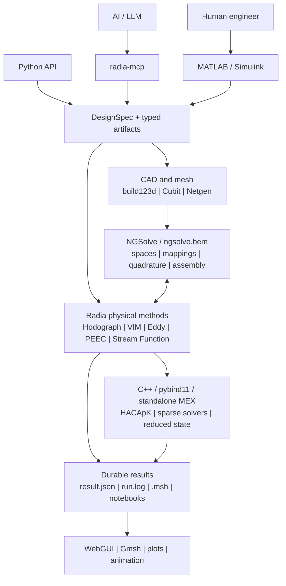

# Radia

<p align="center">
  <strong>Electromagnetic CAE you can operate through AI and MCP</strong><br>
  Connect CAD, mesh control, field analysis, and result inspection on NGSolve,
  with Python, MCP, MATLAB, and Simulink interfaces.
</p>

<p align="center">
  <a href="https://github.com/ksugahar/Radia/actions/workflows/build-test.yml"></a>
  <a href="https://github.com/ksugahar/Radia/actions/workflows/radia-mcp-matrix.yml"></a>
  <a href="https://pypi.org/project/radia/"></a>
  <a href="https://pypi.org/project/radia-mcp/"></a>
  <a href="https://github.com/ksugahar/Radia/releases"></a>
  <a href="LICENSE"></a>
  <a href="https://github.com/ksugahar/Radia/stargazers"></a>
</p>

<p align="center">
  
</p>
<p align="center">
  <sub>Design for a field target: a stream-function active-shield demonstration.
  This comparison is for the illustrated coil configuration, not a universal
  shielding-performance claim.</sub>
</p>

**You set the analysis direction. AI helps operate the CAE tools.**

Radia is an open-source electromagnetic CAE platform that an AI assistant can
operate through MCP. Specify the analysis task and conditions; connected tools
can prepare geometry, control meshing, execute supported calculations, and
inspect results. This reduces the need to memorize each tool's commands and
interaction sequences while keeping the model and results inspectable.

The distributions are independent within this monorepo:

| Distribution | Runtime and integration scope |
| --- | --- |
| `radia` | CPU electromagnetic execution through Python/pybind11 and NGSolve |
| [`radia-gpu`](packages/radia-gpu/README.md) | CUDA MEX, MATLAB, Simulink and LTspice integration code |
| [`radia-mcp`](packages/radia-mcp/README.md) | AI tools and knowledge spanning both distributions |

The normal `radia` distribution excludes CUDA MEX, MATLAB, Simulink and LTspice
integration payloads and dependencies. Install `radia-gpu` separately for those
interfaces. External products are installed separately under their own licenses.

Start from supported CAD, mesh, or model data where available, instead of
rebuilding every input. What transfers depends on the format and workflow;
materials, sources, boundary conditions, and units still need to be checked.
The user defines the physical assumptions, analysis plan, and acceptance criteria
and evaluates the engineering conclusions. Radia's current positioning is
AI-operable CAE, not autonomous design decision-making.

Radia is deliberately **not** another monolithic finite-element solver. It is
built on [NGSolve](https://ngsolve.org/), which remains the numerical
foundation for finite-element spaces, mappings, quadrature, weak forms,
assembly, and field evaluation. Radia adds electromagnetic methods,
open-boundary operators, application workflows, native kernels, and
orchestration around that foundation.

> **Radia extends NGSolve; it does not compete with it.**

[Quick start](#quick-start) | [Capabilities](#capabilities) |
[Simulink](#simulink) | [MCP](#python-and-mcp) |
[Documentation](#documentation) | [Contributing](#contributing)

## Find your next engineering workflow

Use the documentation to discover capabilities and inspect results. Carry out
analysis through MCP, or through human–AI collaboration using Cubit and Simulink.
The executable samples live in [tests/](tests/README.md) for small usage and
contract examples, and [validation_test/](validation_test/README.md) for physics
and application cases with numerical evidence.

[**Start here**](docs/START_HERE.md) · [**Result gallery**](docs/APPLICATION_GUIDE.md#browse-results) ·
[**Accuracy and validation**](docs/VALIDATION_GUIDE.md)

| Explore | What you will find |
| :--- | :--- |
| [Calculate your first field](#quick-start) | A small analytical magnet example with SI inputs and output |
| [See geometry and results](docs/APPLICATION_GUIDE.md#browse-results) | A curved coil, motor torque and thermal response, linked to their conditions and saved calculations |
| [Inspect the numerical evidence](docs/VALIDATION_GUIDE.md) | Analytical references, force checks, holdout comparisons and their limits |
| [Choose an interface and get help](docs/START_HERE.md#choose-how-you-want-to-work) | Python/MCP, MATLAB/Simulink, installation and reproducible issue reports |

## Why Radia?

- **Operate CAE through an AI assistant.** Use MCP to invoke supported operations
  from a stated analysis task, reducing tool-specific command and UI memorization.
- **Build on existing inputs.** Reuse supported geometry, meshes and model data,
  with explicit checks on the physical information carried into the calculation.
- **Connect geometry, mesh and analysis.** Drive CAD operations through MCP and
  control the mesh through the connected meshing workflow before solving.
- **Use optimization when you choose it.** Run coil, material, geometry or other
  supported optimization workflows with user-defined objectives and constraints.
- **Open boundaries are first-class.** Combine analytical source fields,
  Kelvin and DtN techniques, volume and boundary integral methods, SIBC, and
  model reduction without automatically surrounding every problem with a
  large air mesh.
- **AI and humans share the engineering contract.** Python and MCP are the
  first-class AI surface; supported MATLAB and masked Simulink blocks provide
  human-facing composition through the independent GPU package. Each workflow
  has its own validation scope and inspectable artifacts.
- **The numerical backend stays visible.** NGSolve owns finite-element
  mathematics. Radia supplies the missing physical operator or coupling and
  keeps independent analytical or integral routes where they improve trust.
- **Integration is a feature.** build123d, Coreform Cubit, Netgen, Gmsh,
  LTspice, MATLAB, Simulink, NumPy, SciPy, MKL, HACApK, and proven sparse
  solvers are connected through explicit boundaries instead of reimplemented.
- **Results carry evidence.** Production runs write checked meshes, logs,
  machine-readable result metadata, and visualization artifacts. Executable
  samples in `tests/` and `validation_test/` show expected behavior;
  documentation notebooks introduce features through saved results.

## What can you build?

| Engineering need | Radia route |
| :--- | :--- |
| Permanent magnets and coils | Analytical Radia source fields, CAD-driven coils, multipoles, forces, and open-space evaluation |
| Soft magnetic materials | HDiv-VIM, magnetic-moment and multipole-moment methods, nonlinear material laws, and HACApK charge-Gram operators |
| Accelerator and precision magnets | Clebsch-Hodograph pole design, field quality and multipoles, isochronous topology optimization, and charged-particle tracking |
| Eddy currents and shielding | NGSolve HCurl workflows, BEM-A, SIBC, ESIM, cohomology-aware formulations, and reduced transient models |
| Coil and current-sheet design | Stream-function inverse design, ACA+ / TSVD compression, contour extraction, and manufacturable single-stroke paths |
| Conductors and circuits | PEEC, proximity and skin effects, PRIMA/Foster reduction, SPICE export, KiCad/LTspice workflows, and circuit-field coupling |
| Induction heating | Geometry-to-operator assembly, distributed Eddy/Thermal Simulink blocks, temperature fields, and checked Gmsh outputs |
| Motors and magnetic levitation | Angle-periodic native reduced models, HCurl/Foster moving plants, Lorentz force, and Simulink control integration |
| Electromagnetic optimization | TPE, CMA-ES, MMA, SQP, adjoints, density/shape optimization, sheet-metal deformation, and CAD/mesh regeneration |
| Post-processing | Saved NGSolve WebGUI scenes, Gmsh field views, LIC, isosurfaces, streamlines, sweeps, and flying particle-orbit animations |
| TeX equation authoring | Eqnedit64 structural/TeX dual editing, keyboard-first templates, and native Office Math or image clipboard export |

## Quick start

The current production wheel targets **Windows x64**, **Python 3.12**, and
**NGSolve/Netgen 6.2.2607**.

```powershell
python -m pip install --upgrade radia
```

Evaluate an analytical open-boundary magnetic field in SI units:

```python
import numpy as np
import radia as rad

mu0 = 4.0 * np.pi * 1e-7
remanence_t = 1.2

magnet = rad.ObjRecMag(
    [0.0, 0.0, 0.0],
    [0.01, 0.01, 0.01],
    [0.0, 0.0, remanence_t / mu0],
)

b_t = rad.Fld(magnet, "b", [0.0, 0.0, 0.02])
print(f"Bz [T] = {b_t[2]:.8f}")
rad.UtiDelAll()
```

```text
Bz [T] = 0.02356629
```

This first example needs no air mesh. Move to NGSolve when the problem needs
finite-element spaces, material domains, weak forms, or coupled field
equations.

Turn solved SI field samples into electromagnetic force and torque through
Lorentz volume integration, air-side Maxwell stress, time-averaged complex
phasors, virtual work/coenergy, or a cylindrical air-gap shear estimate:

```python
from radia.force import integrate_lorentz_force

# One quadrature sample: J = 2 MA/m^2 in +z, B = 0.3 T in +y,
# with 2.5 cm^3 of physical volume. The force points in -x.
force_n = integrate_lorentz_force(
    [0.0, 0.0, 2.0e6],
    [0.0, 0.3, 0.0],
    2.5e-6,
)
print(force_n)  # [-1.5, 0.0, 0.0] N
```

Supplying quadrature positions and a pivot to
`integrate_lorentz_force_and_torque` returns both resultants. The same
contracts are available in MATLAB under `radia.force`, including
`integrateLorentzForceTorque`, `integrateTimeAverageMaxwellSurfaceForceTorque`,
`virtualWorkForce`, and `coenergyTorque`.
The [force and torque validation corpus](validation_test/force_validation/README.md)
records the Lorentz, Maxwell-stress, and virtual-work checks used to verify
signs and force extraction before attaching them to a production field solve.

Install only the integrations you need:

```powershell
# AI-facing domain tools and executable workflow knowledge
python -m pip install radia-mcp

# Coreform Cubit export and strict .vol checking
python -m pip install "radia[cubit]"
cubit-plugin-install
cubit-plugin-install --verify-only

# Optional accelerator tracking and topology-to-CAD workflows
python -m pip install "radia[beam]"
python -m pip install "radia[topopt-cad]"
```

See [Installation](#installation) for MATLAB/Simulink, visualization, and
source-build paths.

## Eqnedit64

[Eqnedit64](tools/eqnedit64) is an independently released Windows equation
editor with a browser edition and Python API. It connects structural input to
UTF-8 TeX and editable Office Math or image export. See the
[3.1.4 release](https://github.com/ksugahar/Radia/releases/tag/eqnedit64-v3.1.4)
and [package documentation](packages/eqnedit64/README.md).

## Architecture



The same engineering model can therefore be driven by an AI agent, a Python
program, or a Simulink composition without making the user-facing interface
the source of numerical truth.

### Responsibility boundaries

| Layer | Owns |
| :--- | :--- |
| **NGSolve / ngsolve.bem** | FE spaces, element orientation, Piola maps, curved geometry, quadrature, weak-form assembly, GridFunctions, and BEM operators |
| **Radia C++ and Python** | Analytical fields, electromagnetic physical methods, open-boundary operators, material/circuit coupling, reduced models, and artifact schemas |
| **MATLAB and Simulink** | Human-facing composition, typed signal flow, lifecycle, controls, monitoring, and native MEX state ownership |
| **radia-mcp** | Executable domain knowledge, tool discovery, workflow selection, validation guidance, and AI orchestration |
| **CAD and visualization tools** | Geometry/mesh authoring and durable inspection through explicit STEP, VOL, MSH, and result boundaries |

## Capabilities

### Executed feature notebooks

These existing notebooks contain saved code outputs. Their linked derivations
and validation records define the evidence scope; saved output is not a new
release acceptance run.

| Feature | Executed introduction | Method and evidence reference |
| :--- | :--- | :--- |
| HDiv-MMM topology optimization | [Density adjoints and exact-void checks](docs/hdiv_vim/isochronous_topopt.ipynb) | [Formulation and verification scope](docs/hdiv_vim/TOPOLOGY_OPTIMIZATION_ISOCHRONOUS.md) |
| NGSolve integration | [Spaces and field evaluation](docs/ngsolve_integration/integration_basics.ipynb) | [NGSolve](https://ngsolve.org/) |
| Stream-function coil design | [Regularization](docs/stream_function/regularization.ipynb) | [Stream-function methods](docs/stream_function/README.md) |
| Spatial effective surface impedance | [ESIM demonstration](docs/esim_spatial/esim_spatial_demo.ipynb) | [ESIM formulation](docs/esim/README.md) |
| Field visualization and trajectories | [Particle orbits](docs/gmsh_post/em_particle_orbits.ipynb) | [Gmsh post-processing](docs/gmsh_post/README.md) |

### Analytical and open-boundary magnetics

Radia retains the analytical magnetostatic strengths of the original Radia
project: permanent magnets, coils, source fields, forces, energies, and field
evaluation in open space. Around those sources, the current platform provides
Kelvin transformations, exterior DtN formulations, infinite elements,
equivalent sources, and integral formulations for problems where truncating a
large air domain is undesirable.

Radia targets the **magneto-quasi-static to Darwin regime**. Its propagation
kernels are Laplace kernels; frequency enters conductor physics through skin
depth, impedance, and reduced dynamics. Radia is not a full-wave Helmholtz
solver for radiation-dominated problems.

### Clebsch-Hodograph design

Hodograph methods transform selected nonlinear magnetic-design problems into
tractable design problems in a transformed coordinate space. The implementation
supports flux-line and pole-face design, field-quality studies, end effects,
and accelerator-magnet workflows.

- [Clebsch-Hodograph documentation](docs/clebsch_hodograph/README.md)
- [Result-bearing accelerator design notebooks](docs/clebsch_hodograph/demos/README.md)

### HDiv-MMM topology optimization and magnetic materials

HDiv-MMM (the HDiv magnetic-moment method) is the priority development route
for material topology optimization. Its density adjoints, constrained design
loops and exact-void checks are demonstrated on verification-scale models;
these do not establish engineering-scale optimization acceptance.

The HDiv Volume Integral Method uses NGSolve meshes and finite-element spaces
while Radia supplies the magnetic charge-Gram and open-boundary interaction.
The C++ HACApK path provides compressed operators for large repeated actions,
and the Python surface uses NGSolve's field and space vocabulary.

This is Radia's forward path for soft magnetic materials, nonlinear
magnetization, demagnetizing fields, topology-aware material design, and
independent FEM/integral cross-checks.

- [HDiv-VIM documentation](docs/hdiv_vim/README.md)
- [Open-boundary method map](docs/open_boundary/OPEN_BOUNDARY_MAP.md)

### Eddy currents, SIBC, and ESIM

Radia combines high-order NGSolve HCurl discretizations with BEM-A, surface
impedance, effective surface impedance, cohomology handling, and reduced
models. The `Eddyable` concept packages response bases for repeated
low-frequency solves while preserving the underlying field formulation.

- [Eddy-current method guide](docs/solver/EDDY_CURRENT_METHODS.md)
- [ESIM formulation and usage](docs/esim/README.md)
- [Foster, PRIMA, and Modal-bulk SIBC models](docs/solver/REDUCED_EDDY_MODELS.md)

### Stream functions and coil topology

The stream-function layer solves inverse source problems for target magnetic
fields, supports regularized ACA+ / TSVD compression, extracts current
contours, and turns them into connected winding paths. It is used for planar,
cylindrical, and free-form current sheets as well as field-shaping and coil
optimization.

- [Stream Function documentation](docs/stream_function/README.md)
- [Single-stroke winding policy and algorithms](docs/stream_function/single_stroke.md)

### PEEC, circuits, and model reduction

PEEC workflows cover partial inductance, resistance, proximity and skin
effects, shield coupling, circuit assembly, and SPICE-compatible extraction.
PRIMA, block Lanczos, Foster modal models, and universal relaxation networks provide reusable
reduced models for circuit and transient studies.

The `radia-gpu` distribution owns LTspice integration, including
`radia_gpu.ltspice` and the MATLAB `radia.ltspice` namespace. It connects
SPICE netlists, editable LTspice
schematics, KiCad-derived circuits, RAW results, and sampled-data Simulink
plants. Circuit conversion has one Python source of truth and exposes checked
MATLAB adapters.

- [PEEC integration](docs/peec_integration/README.md)
- [SPICE and LTspice integration](docs/ltspice/README.md)
- [Universal relaxation networks](docs/universal_relaxation_network/model_inventory.md)

### Optimization and geometry regeneration

Radia supports global, local, and gradient-based design loops:

- TPE, CMA-ES, GP, NSGA-II/III, QMC, and finite define-by-run search;
- MATLAB-native Optuna 5.0.0-oracled Study/Trial workflows, table-backed
  resume/replay, parameter importance, termination callbacks, automatic
  sampler routing, and live Pareto monitoring;
- analytic-adjoint MMA and SQP for continuous field optimization;
- HDiv-VIM and HCurl material topology;
- stream-function, sheet-metal, and electromagnet topology optimization;
- density/level-set to watertight STL and checked Cubit/Netgen mesh
  regeneration.

Optimization is tied to the same mesh, material, result, and provenance
contracts as direct analysis. A new geometry is not accepted merely because
an optimizer produced it.

### Accelerator fields and particle trajectories

Radia's C++ core provides inspectable SI field sampling, relativistic Lorentz
equations, RK4/Boris steps, fixed-step trajectories, and distributed R/T/U
transfer attribution. It can also hand solved magnetic fields to CERN Xsuite
for accelerator-coordinate tracking or use SciPy for adaptive trajectories,
event handling, and closed-orbit workflows. Gmsh exports preserve trajectory
quantities and can animate a beam through the solved field.

For high-order map analysis, NGSolve remains the source of truth for conforming
HCurl/HDiv projection and curved finite-element evaluation. Radia adds a
tracking-specialized CanonicalHCurl vacuum chain fitted from full-volume field
samples, with adaptive fringe grading, periodic ring closure, and direct
longitudinal-polynomial coupling to a nonautonomous fourth-order Lie-map
integrator. Independent canonical A-map and projected B-map Runge--Kutta routes
keep field-projection error separate from Lie truncation error.

<p align="center">
  
</p>

- [Executed particle-orbit notebook](docs/gmsh_post/em_particle_orbits.ipynb)
- [Native beam and transfer API design](docs/api/EARLY_TIMES_CPP_API_DESIGN.md)
- [Canonical HCurl and Lie-map validation](validation_test/ffag_topopt/README.md)
- [Gmsh post-processing guide](docs/gmsh_post/README.md)

## Interfaces

### Python and MCP

Python is the complete programmable API. MCP makes the same platform
discoverable and executable by AI agents.

The user chooses the analysis purpose, assumptions and success criteria. An AI
assistant uses the available MCP tools to carry out the requested operations and
return inspectable artifacts. Tool execution can be automated; responsibility
for the analysis plan and engineering judgement remains with the user.

The [radia-mcp package](packages/radia-mcp/) provides domain servers for Radia,
NGSolve, Gmsh, build123d, PEEC, induction heating, optimization,
materials, electric machines, accelerator magnets, and supporting engineering
knowledge. It is intentionally lightweight at import time: knowledge and
contract tools can run without loading the full native Radia/NGSolve stack.
`cubit-mesh-export` independently owns the Cubit MCP server.

```powershell
python -m pip install radia-mcp
```

Treat `radia-mcp` as the executable operating manual for agent-driven work.
The top-level README explains the platform; MCP returns the current workflow,
arguments, prerequisites, failure modes, and validation route for a concrete
operation.

- [MCP package and client setup](packages/radia-mcp/README.md)
- Use each server's live `tools/list` response for the authoritative tool
  inventory; the checked `radia_mcp.meta` catalog supplies discovery metadata.

### MATLAB and native MEX

Use the independently distributed [radia-gpu](packages/radia-gpu/README.md).
Its supported solver route is MATLAB mexcuda, with explicit transfer and
numerical validation against Python CPU execution.
CPU execution belongs to `radia` through Python/pybind11/NGSolve.
GPU execution belongs to `radia-gpu` through MATLAB mexcuda.
CPU Radia MEX is unsupported. NGSolve owns finite-element assembly.
Choose Visual Studio Build Tools and CUDA versions supported by the target
MATLAB mexcuda release; do not override unsupported compiler checks.
Build with `Build.ps1 -CudaMexOnly -RequireNativeProvenance`.

`radia-gpu` is under active development: acceptance is specific to the solver
and model tested. Poisson validation does not certify AMS, ICCG or HDiv-MMM.
See its [package guide](packages/radia-gpu/README.md) for current build and
validation scope.

MathWorks' official MATLAB MCP Server and Simulink Agentic Toolkit own generic
MATLAB/Simulink operations; `radia-mcp` adds domain and distribution contracts.

### Simulink

`radia-gpu` owns the readable CUDA PCG Level-2 S-Function, typed ports and
lifecycle checks. Standalone numerical MEX remains independently callable.
`radia-optuna` independently owns its optimization blocks. Use only models
covered by the owning distribution's current native and Simulink validation;
a source file alone does not establish supported GPU execution.

### Documentation and visualization

`docs/**/*.ipynb` is the feature-introduction layer. Demonstrations are
executed notebooks with narrative, code, saved results, and
saved `ngsolve.webgui.Draw` or `netgen.webgui.Draw` scenes. They are not hidden
production workbenches. Executable samples live in `tests/` and
`validation_test/`. Benchmarks and numerical evidence live under
`validation_test/` with machine-readable JSON; docs notebooks need no sidecar.

Field-producing application runs write checked Gmsh `.msh v4.1` artifacts.
The Gmsh toolchain supports scalar/vector/tensor fields, sections, clipping,
isosurfaces, LIC, streamlines, file-series statistics, shared-camera
comparisons, and particle-track animation. Geometry is shown at physical
1:1:1 axis scale unless an explicit display exaggeration is recorded.

## Engineering contracts

Radia favors fail-loud, inspectable boundaries over convenient ambiguity.

| Contract | Rule |
| :--- | :--- |
| Units | Public geometry and field APIs use SI units; geometry is in meters and magnetic flux density is in tesla |
| Physical regime | Magneto-quasi-static to Darwin; Laplace propagation kernels, no hidden full-wave Helmholtz path |
| Finite elements | NGSolve owns orientation, mappings, quadrature, assembly, and GridFunction evaluation |
| Mesh interchange | Netgen `.vol` is the solver mesh boundary; STEP is geometry, not a labeled solver mesh |
| Mesh acceptance | Every solver-bound VOL passes `check-vol`; production modes add strict, versioned label contracts |
| Results | Runs write `run.log`, `result.json`, checks, hashes, and spatial `.msh` output where a field exists |
| Native state | MEX handles validate type, generation, ownership, and liveness; stale handles fail loudly |
| Release | Package versions, compatibility constants, source hashes, native assets, and Simulink archives are checked across independent hosts before publication |

For Cubit-to-NGSolve workflows, Cubit produces the mesh and Radia/NGSolve
consumes it. The exporter does not infer material constants from labels;
conductivity, permeability, BH data, frequency, and other physics remain
explicit configuration.

## Installation

### Supported production stack

| Component | Current target |
| :--- | :--- |
| Operating system | Windows 10/11 or Windows Server, x64 |
| Python core | 3.12 |
| Lightweight radia-mcp | Python 3.10 or later |
| NGSolve / Netgen | 6.2.2607 |
| MATLAB / Simulink package | R2026a, Windows x64 |
| Coreform Cubit | 2026.8, optional |
| cubit-mesh-export Python | >=3.12,<3.13 |
| Native build | Visual Studio Build Tools, CMake/Ninja, pip `mkl-devel` oneMKL; mexcuda toolchain follows MATLAB support |

### Python packages

This monorepo contains six independently versioned distributions. MATLAB,
Simulink and LTspice integration belongs to `radia-gpu`, including its
Python circuit-conversion and parser modules.

| Package or extra | Install | Purpose |
| :--- | :--- | :--- |
| `radia` | `python -m pip install radia` | C++ core, Python APIs, NGSolve integration, physical methods, and application logic |
| `radia-gpu` (source version 0.1.5rc1) | `python -m pip install radia-gpu` | MATLAB mexcuda solvers, Simulink and LTspice integrations; external products installed separately |
| `radia-mcp` | `python -m pip install radia-mcp` | AI-facing MCP servers and executable domain knowledge |
| `cubit-mesh-export` (2.2.3) | `python -m pip install cubit-mesh-export` | Solver-neutral high-order Cubit export, `check-vol`, plugin, and independently owned Cubit MCP |
| `radia-optuna` | `python -m pip install radia-optuna` | Standalone MATLAB Optuna namespace and 21-command native gateway; no Radia solver, NGSolve, or MKL runtime |
| `eqnedit64` (3.1.4) | `python -m pip install eqnedit64` | Windows equation editor, structural Python API, native TeX/MathML/SVG/clipboard backend, and Web assets |
| `radia[optuna]` | `python -m pip install "radia[optuna]"` | Radia plus pinned upstream Python `optuna==5.0.0`; MATLAB optimization requires the separate `radia-optuna` distribution |

Each distribution has its own release and validation gates. Record exact
package versions when reproducing a calculation. See the
[GitHub Releases page](https://github.com/ksugahar/Radia/releases) for artifacts
and release notes; the source version above is not a claim of a stable GPU release.

### Build from source

```powershell
git clone https://github.com/ksugahar/Radia.git
Set-Location Radia
python -m pip install -e ".[dev]"
python -m pip install -e packages/radia-mcp
python -m pip install -e packages/cubit-mesh-export
python -m pip install packages/eqnedit64
pwsh -NoProfile -ExecutionPolicy Bypass -File .\Build.ps1 -RadiaOnly
```

See [BUILD.md](BUILD.md) for compiler, NGSolve, MKL, and packaging details.

## Repository map

```text
src/core/                       C++ Radia and native electromagnetic kernels
src/radia/                      CPU Python package and NGSolve integration
packages/radia-gpu/             CUDA MEX, MATLAB, Simulink and LTspice integration
packages/radia-mcp/             MCP servers and executable domain knowledge
packages/cubit-mesh-export/     Cubit exporters, plugin and check-vol
packages/radia-optuna/          Independent MATLAB/Simulink Optuna package
packages/eqnedit64/             Windows Eqnedit64 Python/API distribution
tools/eqnedit64/                Native and browser equation editor source
tests/                          Small executable samples and fast regressions
validation_test/                Physics/application samples and validation gates
docs/                           Feature introductions, saved results and theory
tools/                          Build, policy, release and verification tools
```

Loose `examples/` scripts are retired. New experiments begin outside the
repository and are promoted only when they become a reusable API, focused
test, validation problem, or result-bearing docs notebook.

## Documentation

Start with the path closest to your task:

- [Documentation index](docs/README.md)
- [Python API reference](docs/api/API_REFERENCE.md)
- [Radia and NGSolve integration notebook](docs/ngsolve_integration/integration_basics.ipynb)
- [Analytical electromagnetic formulas](docs/analytical_formulas.md)
- [HDiv-VIM](docs/hdiv_vim/README.md)
- [Clebsch-Hodograph](docs/clebsch_hodograph/README.md)
- [Eddy-current methods](docs/solver/EDDY_CURRENT_METHODS.md)
- [Stream Function](docs/stream_function/README.md)
- [PEEC integration](docs/peec_integration/README.md)
- [Induction heating](docs/induction_heating/README.md)
- [Electric machines](docs/electric_machine/README.md)
- [Magnetic levitation](docs/maglev/demos/README.md)
- [Gmsh post-processing](docs/gmsh_post/README.md)
- [MATLAB and Simulink](packages/radia-gpu/matlab/README.md)
- [MCP servers and tools](packages/radia-mcp/README.md)
- [Cubit mesh export](docs/cubit_mesh_export/README.md)

## Contributing

Radia welcomes focused contributions to physical methods, NGSolve-native
integration, independent validation, CAD/mesh boundaries, MATLAB/MEX parity,
documentation, and application workflows.

```powershell
# Run one focused regression while developing
python -m pytest -q tests/test_vim_eddy_hybrid.py

# Broaden only after the focused lane is green
python -m pytest -q tests
```

Fast regressions belong in `tests/`. Long numerical studies, convergence
sweeps, and benchmark-quality checks belong in `validation_test/`. These two
directories also provide executable samples. Feature introductions and saved
demonstrations belong under `docs/`; operational workflows use MCP or
human–AI collaboration through Cubit and Simulink.

- Read [CONTRIBUTING.md](CONTRIBUTING.md) before opening a pull request.
- Use the [issue tracker](https://github.com/ksugahar/Radia/issues) for bugs and
  concrete feature requests.
- Report vulnerabilities through the private process in
  [SECURITY.md](SECURITY.md).
- Include the smallest reproducible geometry/configuration and the generated
  `result.json` or checker report when reporting a numerical workflow issue.

If Radia is useful to your engineering or research, **star the repository**.
It helps other electromagnetic developers discover the project and follow its
progress.

## Project status

Radia is an active research and engineering platform. The core analytical
magnetostatics package is mature; newer VIM, Eddy, optimization, MATLAB/MEX,
and Simulink families are developed behind explicit tests and release gates.
Not every method has the same maturity or platform coverage, and unsupported
paths are expected to fail loudly rather than select a weaker substitute.

Current priorities are:

1. complete and validate HDiv-MMM topology optimization, including scalable
   open-boundary operators and independent numerical checks;
2. improve repository and `radia-mcp` quality, maintenance, validation,
   build, CI, packaging, and release operation;
3. deepen Eddy, SIBC/ESIM, PEEC, Foster reduction, and thermal coupling;
4. expand measured Python/MATLAB/MEX parity and native Simulink dynamics;
5. improve executed documentation, independent validation, and reproducible
   application artifacts.

## Heritage, acknowledgements, and license

Radia originates from the magnetostatics work developed by Oleg Chubar,
Pascal Elleaume, and collaborators at the European Synchrotron Radiation
Facility. The current project extends that heritage with NGSolve integration,
open-boundary engineering methods, high-order formulations, optimization,
native MATLAB/Simulink interfaces, and AI-oriented automation.

We gratefully acknowledge Joachim Schöberl and the Netgen/NGSolve development
team and community for the numerical foundation that makes these workflows
possible. [NGSolve](https://ngsolve.org/) provides the finite-element spaces,
geometric mappings, quadrature, assembly, and field evaluation on which Radia
builds its electromagnetic applications. Radia also integrates the
HACApK H-matrix library, sparseSolv, Netgen, Gmsh, build123d, Coreform Cubit,
and the broader Python/MATLAB scientific ecosystems.

The repository contains components under different compatible terms,
including the BSD-style Radia core, MIT-licensed HACApK, MPL-2.0 sparseSolv
integration, and redistributable runtime notices. See [LICENSE](LICENSE) for
the complete terms.
