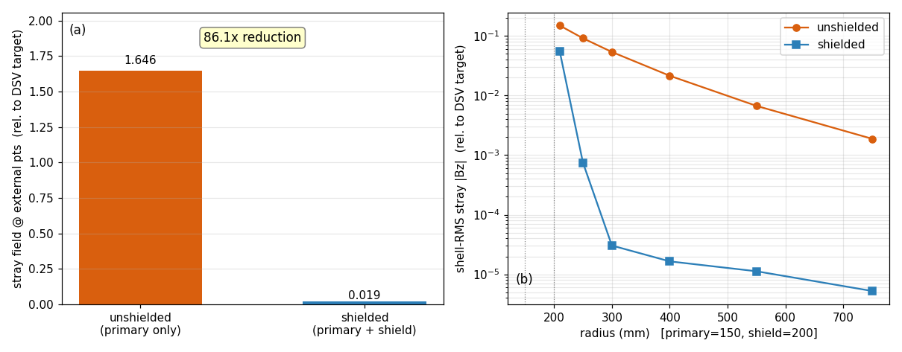

# Explore Radia

**Operate electromagnetic CAE through AI and MCP, with an analysis plan you define.**
These pages introduce capabilities through geometry, mesh, field and result
views. Operate CAE through MCP, or collaborate with AI using Cubit and Simulink.
AI-assisted tool operation reduces the burden of
learning each tool's commands; the physical assumptions and engineering
decisions remain yours.

*Design for a field target: external stray fields in a stream-function
active-shield demonstration. The plotted comparison applies to this coil
configuration; it is not a general performance guarantee.*

[**Guided start and FAQ**](START_HERE.md) · [**Application examples**](APPLICATION_GUIDE.md) ·
[**Accuracy and validation**](VALIDATION_GUIDE.md)

Start with the [six selected applications](APPLICATION_GUIDE.md#browse-results).
For convergence, formulation comparisons and research evidence, use the
[validation study index](../validation_test/STUDY_INDEX.md).

## Notebook index

The documentation notebooks are listed by topic. Saved outputs illustrate the recorded runs.
For validation scope, see the [validation guide](VALIDATION_GUIDE.md).

### Fundamentals

- [Analytical formula examples (IEE Japan Part 1-9)](analytical_formulas/analytical_formulas.ipynb)
- [AXIFEM notebooks](axifem/README.ipynb)
- [Background fields: the `ObjBckg` callback API](background_fields/background_fields.ipynb)
- [Cubit Export Showcase](cubit_export/cubit_export_showcase.ipynb)
- [GMSH Displacement Animation Artifact](gmsh_animation/gmsh_animation.ipynb) (historical output)
- [Gmsh Animation Export](gmsh_animation/gmsh_animation_export.ipynb)
- [EM field-line and isosurface post-processing (gmsh lane)](gmsh_post/em_fieldlines.ipynb)
- [Post-processing gallery: one DC magnet through every verb](gmsh_post/em_post_gallery.ipynb)
- [Radia <-> NGSolve integration basics](ngsolve_integration/integration_basics.ipynb)
- [Radia basics -- small worked problems](simple_problems/simple_problems.ipynb)

### Formulations and validation

- [BEM inductance on closed surfaces: a limitation (and what to use instead)](bem_extractor/bem_inductance_limitations.ipynb)
- [Genus-1 loop DOF: how the cohomology cut is selected](cohomology/loop_dof_cut_selection.ipynb)
- [T-Omega magnetostatics with a gmsh-free cohomology cut](cohomology/tomega_wire.ipynb)
- [Cubit Mesh Evaluation p-Convergence Demo](cubit_export/netgen/p_convergence_demo.ipynb)
- [EM reference audit — the diagnostics that exonerate (or convict) a FEM cross-validation reference](electric_machine/em_reference_audit.ipynb)
- [Electrostatics validation suite](electrostatics/electrostatics.ipynb)
- [Equivalence source (NearFieldSource): demos](equivalence_source/demos.ipynb)
- [C-type magnet: HDiv-MMM, reduced-A, and mixed total/reduced Omega](hdiv_vim/c_type_three_formulation_mixed_omega.ipynb)
- [HDiv-VIM -- curved-geometry accuracy win (showcase)](hdiv_vim/hdiv_curved_showcase.ipynb)
- [Matching total and reduced magnetic scalar potentials](hdiv_vim/mixed_omega_planar_interface.ipynb)
- [Analytical-material-model hysteresis on the loop-free HDiv-VIM](hysteresis/hdiv_real_material.ipynb)
- [Hysteresis models: Play & Energy validation gallery](hysteresis/hysteresis_validation.ipynb)
- [Does the temperature rise match the supplied heat?](induction_heating/axisymmetric_p2_thermal.ipynb)
- [ESIM induction-heating benchmark -- verified results validation](induction_heating/induction_heating_demo_showcase.ipynb)
- [CG-Smoother Acceleration for Equilibrated Error Estimation](kelvin/Supplement/cg_smoother_demo.ipynb)
- [Kelvin transformation: the exterior source, the twisted pullback, and A-Phi at p = 2](kelvin/kelvin_exterior_source_and_aphi.ipynb)
- [Mesh Fusion in NGSolve -- 5-phase non-conforming coupling study](mesh_fusion/mesh_fusion.ipynb)
- [Krylov + SIBC (with HOIBC corrections) -- verified results showcase](mixed_galerkin/mixed_galerkin_results.ipynb)
- [Nodal Force (Eggshell) Method -- 2D EM force, three ways](nodal_force/nodal_force.ipynb)
- [Open boundary: exact DtN and Foster diffusion memory](open_boundary/open_boundary_demo.ipynb)
- [Dowell Surface Impedance -- Executable Companion](peec/dowell_surface_impedance_demo.ipynb)
- [PEEC integration -- historical results showcase](peec_integration/peec_showcase.ipynb)
- [Surface-deformation companion (executable) — bilevel optimisation](stream_function/deformation.ipynb)
- [Regularisation companion (executable) — FE-direct `psi`](stream_function/regularization.ipynb)
- [URN to Convolution Quadrature Bridge](universal_relaxation_network/cq_urn_bridge.ipynb)
- [Universal Relaxation Network (URN) -- historical results showcase](universal_relaxation_network/urn_showcase.ipynb)

### Applications

- [Vertical edge focusing of a tilted dipole end -- measured by particle tracking](clebsch_hodograph/edge_focusing_tracking.ipynb)
- [Excitation-invariant flux lines — same field-line shape as the drive current rises](clebsch_hodograph/excitation_invariant_field.ipynb)
- [2D bending-magnet END in the s-y (longitudinal) plane: fringe feasibility + end-shaping design](clebsch_hodograph/hodograph_bending_sy.ipynb)
- [2D linear hodograph: the feasibility *and* the transparency of a bending-magnet field](clebsch_hodograph/hodograph_feasibility_2d.ipynb)
- [Clebsch Hodograph Public Demo](clebsch_hodograph/public_demo.ipynb)
- [Inspect the field of a complex coil](complex_coil_geometry/complex_coil.ipynb)
- [Can a reduced motor model predict torque between sampled angles?](electric_machine/angle_periodic_motor_rom.ipynb)
- [Compare motor torque ripple and skew](electric_machine/cogging_skew_demo.ipynb)
- [Planar HDiv-VIM for electric machines — nonlinear iron, rotation sweep, torque, eddy coupling, induction](electric_machine/planar_vim_motor.ipynb)
- [Frequency-dependent induction-heating power](esim_spatial/esim_spatial_demo.ipynb)
- [Bend electron trajectories with a saddle coil](gmsh_post/em_particle_orbits.ipynb)
- [Isochronous topology optimization on HDiv-MMM: density adjoint, constrained design loop, exact-void verification](hdiv_vim/isochronous_topopt.ipynb)
- [Frequency-dependent magnetic lift on a conducting sphere](maglev/maglev_showcase.ipynb)
- [Constrained CAE optimization with Optuna (RF waveguide design)](optimization/optimization.ipynb)
- [Section-optics inverse design](section_optics/section_optics_design.ipynb)
- [A spherical winding for a target field](stream_function/theory.ipynb)

## Choose a Starting Point

| What would you like to do? | Start here |
| :--- | :--- |
| Work with NGSolve from MATLAB | [Native mesh, space, and matrix walkthrough](../packages/radia-simulink/README.md) |
| See Radia and NGSolve working together | [Integration notebook with saved results](ngsolve_integration/integration_basics.ipynb) |
| Design coils and current sheets | [Stream-function applications](stream_function/application.md) |
| Connect a circuit to a field workflow | [LTspice integration](ltspice/README.md) |
| Build a MATLAB/Simulink application | [Radia library and native MEX interfaces](../packages/radia-simulink/README.md) |
| Explore magnetic materials and open boundaries | [HDiv-MMM](hdiv_vim/README.md) and [Kelvin transformation](kelvin/KELVIN_TRANSFORMATION.md) |

The native MATLAB interface retains selected NGSolve objects in C++; it is more
than a launcher for a Python script. Other capabilities use explicitly declared
Python batch fallbacks. Check the [backend map](../packages/radia-simulink/matlab/python_api_parity_manifest.json)
for the capability you need, and the
[Python/MATLAB validation record](../validation_test/ngsolve_matlab_parity/README.md)
for the tested cases. A demonstration is not a guarantee for every geometry,
material, or backend.

For installation and supported platforms, see the [Quick start](../README.md#quick-start).
For release-by-release changes, see [CHANGELOG.md](../CHANGELOG.md).

## Introduction, operation and executable samples

| Purpose | Where to go |
| :--- | :--- |
| Understand a capability and its demonstrated scope | This documentation and its saved notebooks |
| Ask AI to carry out analysis operations | [MCP tools and setup](../packages/radia-mcp/README.md) |
| Work with AI on geometry and mesh | [Cubit mesh workflow](cubit_export/README.md) |
| Work with AI on an application model | [Radia Simulink library](../packages/radia-simulink/README.md) |
| Inspect small executable usage and contract examples | [tests/](../tests/README.md) |
| Inspect physics, numerical and application examples with evidence | [validation_test/](../validation_test/README.md) |

The executable sample collection lives in `tests/` and `validation_test/`.
Tests retain their assertions, fixtures and execution requirements; use the
relevant case's setup rather than treating every file as a standalone script.

`docs/**/*.ipynb` introduces features and explains saved results. Each
demonstration keeps its computed outputs and an interactive
`ngsolve.webgui.Draw` scene for the mesh and principal field (or
`netgen.webgui.Draw` for pre-mesh CAD). Static figures may supplement the
scene, but do not replace it. Principal-field scenes pass the field and mesh
explicitly and name/configure the view, for example
`Draw(field, mesh, name="B_magnitude", draw_vol=True, ...)`. Start with
[Radia <-> NGSolve integration basics](ngsolve_integration/integration_basics.ipynb).

Benchmark timing, convergence studies, and golden numerical evidence live in
[`validation_test/`](../validation_test/) with committed JSON provenance.
Docs notebooks are demonstrations and do not require JSON sidecars.

These notebooks introduce capabilities through visible results: the engineering
question, the computed field or design, and a route to trying it yourself.
They are not timing competitions or release-acceptance certificates.
Human–AI collaboration uses Cubit for CAD/mesh work and the masked Simulink
block library for application models. AI-driven Cubit operations run headlessly;
geometry, journals, meshes and checks provide the handoff to human work.
Spatial application results are durable GMSH `.msh v4.2` artifacts in the run
directory; interactive WebGUI scenes support the feature explanation.

### References in Notebooks

The parent bibliography and the `.bbl` generator live in the separate
document-tools repository, not in radia-mcp. Notebook literature references
must come from a `.bbl` generated from that parent, not from a
manuscript-local `.bib` or a separately maintained reference list. Keep the
generated `.bbl` beside the notebook and make its references readable in the
saved notebook. A notebook without literature citations does not need a dummy
bibliography.

Correct citation metadata and keys in the parent, then regenerate the `.bbl`
and its notebook presentation together. Do not hand-edit generated entries.
This is the required authoring policy, not a claim that every legacy notebook
has already passed the bibliography audit.

> **Where is the canonical PEEC / FEM / Cubit knowledge?**
> Per CLAUDE.md "MCP Knowledge Placement Policy", the **single source of
> truth** for PEEC / FEM / Cubit / build123d / GMSH knowledge is the
> `radia-mcp` package's knowledge modules at
> [packages/radia-mcp/src/radia_mcp/](../packages/radia-mcp/src/radia_mcp/),
> not `docs/`.  `docs/` is the **academic / user-facing reference layer** --
> useful for citations and architectural overviews, but not the place to
> look for "how do I do X today".  For runnable how-tos and the current
> recipe for any task, query `radia-mcp` via Claude / your MCP client
> (e.g. `peec_inductance(topic="step_authoring")` returns Cubit + build123d
> recipes for auto-detect-friendly STEPs).

## API Reference

- [API_REFERENCE.md](api/API_REFERENCE.md) - Complete Python API reference: quick start, elements, solvers, NGSolve integration
- [UNIFIED_FIELD_API_DESIGN.md](api/UNIFIED_FIELD_API_DESIGN.md) - Unified `rad.Fld()` dispatch design for static and PEEC solvers

## Solver Architecture

- [EDDY_CURRENT_METHODS.md](solver/EDDY_CURRENT_METHODS.md) - Conductor eddy current modeling: method comparison (NGSolve + ngbem)

## FEEC / HDiv-type VIM

- [hdiv_vim/README.md](hdiv_vim/README.md) - The **HDiv-type Volume Integral Method**: a symmetric FEEC H(div) demag operator `N = B^T G B` whose loop modes are field-null by construction. This is the soft-iron route for Radia going forward.

## Kelvin Transformation

- [KELVIN_TRANSFORMATION.md](kelvin/KELVIN_TRANSFORMATION.md) - Theory, API, workflow, and references for open boundary magnetostatics
- [DTN_SPECTRUM_COARSE_MESH.md](kelvin/DTN_SPECTRUM_COARSE_MESH.md) - **Coarse-mesh accuracy as a DtN-spectrum property** (Kameari's coarse-mesh demonstration, reframed). The exterior Dirichlet-to-Neumann operator `Λ_ext` has the closed-form eigenvalue ladder `−(n+1)/R` (3D) / `−n/R` (2D); the discrete `Λ_h` already lands the low multipoles on that ladder on the coarsest mesh (dipole 0.07%), and the **isolated** Kelvin open-boundary error (~0.1%) sits ~45× below the interior FEM error — readable off the operator before any solve, and separated from the interior discretisation a field-refinement study conflates. Includes the BEM `Λ_h` spectrum, the Kelvin polynomial-image / order-threshold mechanism (mode `n` exact iff FEM order `≥ n`), the 2D static-apparatus / rotating-machine cross-section, and the real two-sphere periodic-Kelvin validation. Runnable layer: `dtn_coarse_mesh(topic=...)`.
- [kelvin/CONVENTION.md](kelvin/CONVENTION.md) - Canonical Kelvin material-factor convention used by the helpers and validation fixtures.

## PEEC (Partial Element Equivalent Circuit)

- [PEEC_PANEL_IMPLEMENTATION.md](peec/PEEC_PANEL_IMPLEMENTATION.md) - Panel-based 2D surface integration implementation
- [PEEC_CONDUCTOR_MODELING_GUIDE.md](peec/PEEC_CONDUCTOR_MODELING_GUIDE.md) - Conductor modeling via `coil_from_cad.py` (5-predicate classification dispatch, RMF, adaptive resampling, cap-centroid endpoint anchoring -- updated for v4.55.0)
- [PEEC_SHIELD_CONDUCTOR.md](peec/PEEC_SHIELD_CONDUCTOR.md) - Shield conductor modeling (`peec_shield.py`)
- [PEEC_SURFACE_IMPEDANCE.md](peec/PEEC_SURFACE_IMPEDANCE.md) - Surface impedance formulation and SPICE export
- [ltspice/README.md](ltspice/README.md) - Built-in `radia.ltspice` conversion, topology gates, CLI, MCP, and MATLAB bridge
- [PEEC/BEM-A convergence validation](../validation_test/peec_bema_convergence/) - Result-bearing 3turnCoil convergence evidence.
- [PEEC solver benchmark validation](../validation_test/solver_benchmarks/README.md) - Dense Ruehli vs HACApK timing, scaling, and crossover evidence kept outside the public demo corpus.

> **For "how do I author a STEP that PEEC can solve?"**: query
> `radia-mcp` `peec_inductance(topic="step_authoring")` for Cubit + build123d
> recipes, anti-patterns, and a 10-line build123d probe script that
> verifies a STEP is auto-detect-friendly BEFORE running the panel.
> The MCP knowledge is the runnable layer; `PEEC_CONDUCTOR_MODELING_GUIDE.md`
> is the architectural / theoretical overview.

## Reduced eddy-current models

- [Foster, PRIMA, and Modal-bulk SIBC](solver/REDUCED_EDDY_MODELS.md) — supported formulations, entry points, and validation limits.

## Transient Kernels

- [universal_relaxation_network/cq_urn_bridge.ipynb](universal_relaxation_network/cq_urn_bridge.ipynb) - Result-bearing URN -> convolution-quadrature bridge: passive relaxation `H(s)`, BDF2 CQ weights, and a periodic IFFT contrast for acoustic FEM/BEM and Maxwell time-domain education.

## Analytical Reference Formulas

- [analytical_formulas.md](analytical_formulas.md) - Closed-form formulas covering Wakao-Igarashi-Fujiwara-Kameari Part 1-9 (IEE Japan SA / RM technical meetings, 2002-2007). Group B + C: ellipsoid demag/torque, AC vector locus, magnetic shielding, 2D rectangular magnet, thin-plate eddy current, Fabri solenoid axial field, three-phase line (triangle / planar / helical), K(k) / E(k) Hastings approximations, Gauss-Legendre. Group D (Part 6/8/9 extensions): plate Joule dissipation, AC thin-shell shielding, magnetic-shell interior fields, planar surface impedance, full Bessel cylindrical-conductor AC impedance, Gauss-Patterson nested quadrature, cuboid average B. Source: [src/radia/analytical_formulas/](../src/radia/analytical_formulas/), tests: [tests/analytical_formulas/](../tests/analytical_formulas/), notebook: [docs/analytical_formulas/analytical_formulas.ipynb](analytical_formulas/analytical_formulas.ipynb).

## Background Fields

- [background_fields/background_fields.ipynb](background_fields/background_fields.ipynb) - Result-bearing `ObjBckg` callback showcase with docs-local helper scripts/assets.

## Coil Design / Inverse Source

- [stream_function.md](stream_function.md) - **(ACA+)+TSVD least-norm solver** (stream function method, generalised). Kernel-agnostic field-synthesis / inverse-source solver `A phi = B` (M field points x N basis sources, M < N): TSVD-regularised pseudo-inverse accelerated by ACA+ low-rank recompression. ACA+ delegated to HACApK (`cHACApK_acaplus`); the matrix entry `A(i,j)` is a caller callback built from Radia's existing field (Biot-Savart for coils, fixed-magnet fields for magnets) via `radia_field_kernel`. Methods 2/3 (IEEJ SA-25-020). Source: [src/radia/stream_function.py](../src/radia/stream_function.py) + `src/core/rad_stream_function.cpp`, tests: [tests/test_stream_function.py](../tests/test_stream_function.py), result-saved notebooks: [docs/stream_function/](stream_function/README.md).
- [complex_coil_geometry/complex_coil.ipynb](complex_coil_geometry/complex_coil.ipynb) - Result-bearing CoilBuilder showcase with docs-local helper scripts.
- [equivalence_source/demos.ipynb](equivalence_source/demos.ipynb) - Result-bearing NearFieldSource / equivalence-theorem showcase synchronized with `validation_test/equivalence_source/` JSON results.

## Visualization

- [MESH_GUIDE.md](visualization/MESH_GUIDE.md) - Mesh generation workflows (Cubit + Netgen)
- [gmsh_animation/gmsh_animation.ipynb](gmsh_animation/gmsh_animation.ipynb) - Historical (stale) Gmsh animation calculation record; not current-format evidence.
- [figures/lab_diagrams/README.md](figures/lab_diagrams/README.md) - Docs-owned TikZ source templates for lab flowcharts and concept diagrams.

## Electric Machines

- [electric_machine/cogging_skew_demo.ipynb](electric_machine/cogging_skew_demo.ipynb) - Result-bearing PM rotor cogging/skew demo; validation-class scripts and JSON evidence live in `validation_test/electric_machine/`.

## Cubit Export

- [Function_Reference.md](cubit/Function_Reference.md) - `export netgen` command and `check-vol` reference
- [Vol_vs_Step_Labels.md](cubit/Vol_vs_Step_Labels.md) - Mesh format routing: .vol carries labels; .step is geometry-only. Why Cubit `export netgen` is the single chokepoint for labeled .vol.
- [Cubit_Element_Order.md](cubit/Cubit_Element_Order.md) - Element order control (1st/2nd order) in Coreform Cubit
- [export_NetgenMesh.md](cubit/export_NetgenMesh.md) - Netgen .vol export (order 1-5, recommended)
- [export_exodus.md](cubit/export_exodus.md) - Exodus II export (Cubit native)
- [NGSolve User Meeting convergence validation](../validation_test/ngsolve_user_meeting/) - Result-bearing OCC `mesh.Curve(p)` sphere volume/area p-convergence evidence.

## Removed (historical reference)

The following features were removed; their docs were deleted to prevent confusion:

- **Nastran BDF input** (Radia-side `.bdf` mesh import): removed. Use checked Netgen `.vol` as the solver mesh input; Gmsh 5 / MSH 4.2 is the post-processing output.
- **Scattered-field Robin RHS** (`docs/FEM_SCATTERED_FIELD.md`): removed 2026-04-24; the formulation could not be made stable enough for production coupling.  The total-field formulation in `calc_fem_kelvin.py` is the shipped path.

See [CHANGELOG.md](../CHANGELOG.md) for the full removal history per release.
